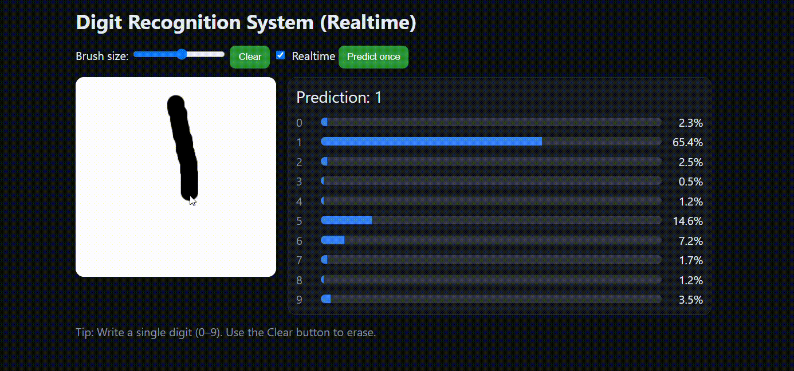

# MNIST Handwritten Digit Recognition - Flask + Real-Time Canvas

[](https://www.python.org/)
[](https://www.tensorflow.org/)
[](https://flask.palletsprojects.com/)
[](LICENSE)
[](https://github.com/nishitdarji11/digit-recognition-system-Real-time)

An interactive web application for recognizing handwritten digits using a CNN model trained on the MNIST dataset.  
Users can draw directly on a browser canvas, and the model will predict the digit in **real-time**.

## Preview
 

## Features
- **CNN Model Training** on the MNIST dataset with a 90/10 train-validation split.
- **Advanced Data Augmentation**: Custom stroke-width adjustments (dilation/erosion) and geometric transformations to improve accuracy on real-world canvas drawings.
- **Flask Web Application** with `/predict` endpoint for inference.
- **Interactive Canvas** in the browser for drawing digits.
- **Real-Time Prediction** while drawing.
- **Preprocessing**: Cropping, scaling, and padding to make input resemble the MNIST format.

## Installation & Running

1. **Clone the repository**
    ```bash
    git clone [https://github.com/nishitdarji11/digit-recognition-system-Real-time.git](https://github.com/nishitdarji11/digit-recognition-system-Real-time.git)
    cd digit-recognition-system-Real-time
    ```

2. **Create a virtual environment & install dependencies**

    ```bash
    python -m venv venv
    venv\Scripts\activate  # Linux/Mac: source venv/bin/activate
    pip install -r requirements.txt
    ```

3. **Train the model**

    ```bash
    python train_mnist.py
    ```

    This script will download the MNIST dataset, apply data augmentation, train the CNN, and save the model in the modern Keras format to `models/mnist_cnn.keras`.

4. **Run the web app**

    ```bash
    python app.py
    ```

    Open your browser at `http://127.0.0.1:5000`.

## Model Training & Architecture

### Data Augmentation Pipeline
To make the model robust to different handwriting styles on the web canvas, the training data passes through an augmentation pipeline before reaching the model:
*   **Geometric Transformations**: Random Rotation (±10°), Translation (±10%), and Zoom (±10%).
*   **Dynamic Stroke Width**: Randomly applies morphological operations (dilation and erosion) so the model learns to recognize both very thin and very thick drawn strokes.

### Convolutional Neural Network (CNN)
1. **Conv2D** (32 filters, 3×3 kernel, ReLU) → **MaxPooling2D**
2. **Conv2D** (64 filters, 3×3 kernel, ReLU) → **MaxPooling2D**
3. **Flatten** → **Dense** (128 units, ReLU) → **Dropout** (0.3 rate)
4. **Dense** (10 units, Softmax) for classifying digits 0–9.

## Performance & Robustness
The updated model utilizing data augmentation is significantly less sensitive to stroke thickness compared to the baseline. The following metrics demonstrate the model's accuracy on clean data versus altered stroke thicknesses:

| Test Set | Baseline Accuracy | Augmented Accuracy |
| :--- | :--- | :--- |
| Clean MNIST | 98.34% | 98.12% |
| Strokes 1 px thicker | 89.55% | 96.36% |
| Strokes 2 px thicker | 53.97% | 90.51% |
| Strokes thinner | 50.45% | 79.35% |

*Note: These comparative metrics were evaluated on a small run of 20,000 training images over 4 epochs. The fully trained model will score higher.*

## License

MIT License.  
Feel free to use, modify, and distribute this project.